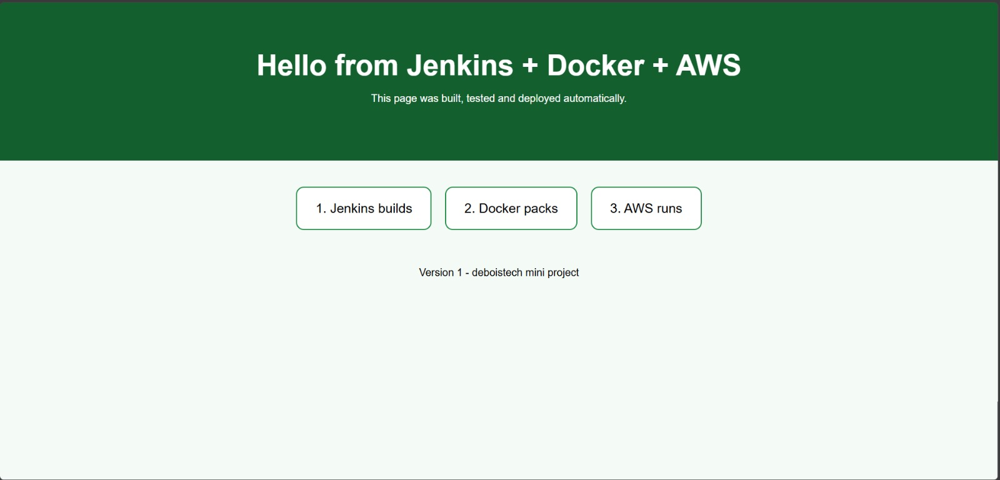

# Hello Jenkins: CI/CD with Jenkins, Docker and AWS

A mini project that automatically builds, tests, and publishes a static web page as a Docker container. A push to GitHub triggers a Jenkins pipeline that builds an Nginx image, validates it, pushes it to Amazon ECR, and serves it from an EC2 instance.

## Architecture

```
GitHub  -->  Jenkins  -->  Docker build & test  -->  Amazon ECR  -->  EC2 (Docker, port 80)
 (code)     (Jenkinsfile)     (nginx:alpine)        (private repo)     (live web page)
```

## Pipeline stages

| Stage | What it does |
|-------|--------------|
| **Checkout SCM** | Pulls the repository and the `Jenkinsfile` from GitHub |
| **Build** | `docker build` creates the image `hello-jenkins:<BUILD_NUMBER>` |
| **Test** | `docker run --rm <image> nginx -t` validates the Nginx configuration |
| **Push** | Logs in to Amazon ECR, tags the image as `latest`, and pushes it |
| **Deploy** | Runs `deploy.json` on the EC2 instance through AWS Systems Manager (SSM). Intended to run only when `INSTANCE` is set to a real instance ID |

## Tech stack

- **Jenkins**: declarative pipeline, credentials store
- **Docker**: image build and test
- **Nginx (Alpine)**: web server
- **GitHub**: source control
- **AWS ECR, EC2, IAM, SSM**: registry, hosting, permissions, remote deployment
- **AWS CLI**: ECR login from the pipeline
- **Groovy / JSON**: pipeline scripting and deployment commands

## Repository structure

```
.
├── Dockerfile      # nginx:alpine image that serves index.html
├── index.html      # the web page
├── Jenkinsfile     # pipeline definition (helpers + stages)
├── deploy.json     # SSM commands run on the EC2 instance
└── README.md
```

## Acknowledgements

Built as a hands-on mini project at **Deboistech** (Jenkins + Docker + AWS).

## Live Demo

